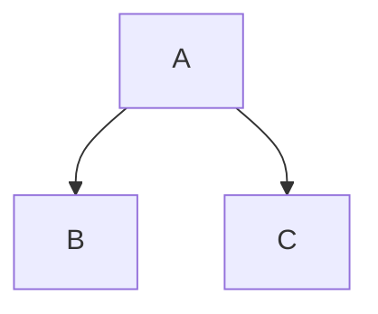

<!-- markdownlint-disable MD025 -->

# Heading 1

## Heading 2

### Heading 3

#### Heading 4

##### Heading 5

###### Heading 6

---

### Heading with Custom ID {#custom-id}

---

## Text Formatting & Emphasis

_Italic text_ or _Italic text_
**Bold text** or **Bold text**
_**Bold and italic**_ or _**Bold and italic**_
~~Strikethrough text~~
==Highlighted text== (Extended / Obsidian)
H~2~O (Subscript - Extended)
X^2^ (Superscript - Extended)
`Inline code`
``Inline code containing a `backtick` ``

Line breaks: End a line with two spaces  
or a backslash\
to create a soft line break.

Leave a blank line between lines to create a new paragraph.

---

## Blockquotes & Callouts

This is a standard blockquote.

> Standard blockquote.
>
> > Nested blockquote.
> >
> > - Lists inside a blockquote
> > - **Bold** text inside a blockquote

This is a GitHub/Obsidian style callout.

> [!NOTE]
> GitHub / Obsidian alert callout (also supports TIP, IMPORTANT, WARNING, CAUTION).

---

## Lists

### Unordered Lists

- Item 3
    - Nested item (indent 2 or 4 spaces)
        - Deeply nested item

### Ordered Lists

1. First item
2. Second item
    1. Nested ordered item
    2. Another nested item
3. Auto-numbered item (using `1.` repeatedly renders sequentially)

### Task Lists (GFM)

- [x] Completed task
- [ ] Incomplete task
    - [x] Nested completed subtask

### Definition Lists (Extended)

Term 1
: Definition 1

Term 2
: First definition of Term 2
: Second definition of Term 2

---

## Code Blocks

### Fenced Code Block with Syntax Highlighting

```javascript
function greet(name) {
    return `Hello, ${name}!`;
}
```

### Fenced Diff Block

```diff
- Removed line
+ Added line
```

---

## Links & Images

### Links

[Inline link](https://example.com)
[Inline link with title](https://example.com 'Hover Title')
[Link to heading ID](#custom-id)
[Reference-style link][ref-id]
[Implicit reference link][]
<https://example.com>
<user@example.com>

[ref-id]: https://example.com 'Optional Title'
[Implicit reference link]: https://example.com

### Images


![Reference-style image][img-ref]

[img-ref]: https://example.com 'Reference Image'

### Linked Image (Often used for Video Thumbnails)

[](https://example.com)

---

## Tables (GFM)

| Left-Aligned    | Center-Aligned  |                       Right-Aligned |
| :-------------- | :-------------: | ----------------------------------: |
| Cell 1          |     Cell 2      |                              Cell 3 |
| **Bold**        |     `Code`      | [Example Link](https://example.com) |
| Escaped pipe \| | Multi-word cell |                            \$100.00 |

---

## Footnotes (GFM / Extended)

Here is a sentence with a footnote[^1] and a named footnote[^note].

[^1]: Standard numbered footnote definition.

[^note]: Named footnote definition that can span multiple paragraphs.

    Indent subsequent paragraphs by 4 spaces.

---

## Math & Diagrams (Extended / KaTeX / Mermaid)

Inline math: E = mc²

Block math:
\[\sum_{i=1}^{n} i = \frac{n(n+1)}{2}\]



---

## Horizontal Rules

---

---

---

---

## Escaping Characters

\*Literal asterisks\*
\# Not a heading
\[Not a link\]
\`Not code\`
\\ Literal backslash

---

## Emoji Shortcodes (GFM / Extended)

:rocket: :sparkles: :thumbsup:

---

## Inline HTML Fallbacks

<kbd>Ctrl</kbd> + <kbd>C</kbd>
<mark>Highlighted via HTML</mark>
H<sub>2</sub>O and X<sup>2</sup>
<u>Underlined text</u>

<details>
<summary>Collapsible Toggle Section</summary>

Hidden content inside a toggle block. Make sure to leave a blank line after `</summary>`.

</details>

<!-- HTML Comment (invisible when rendered) -->
